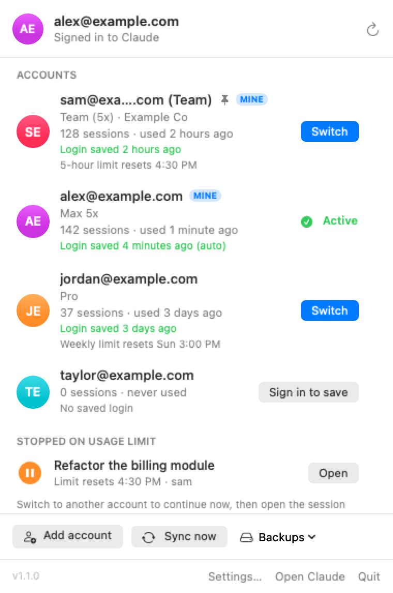
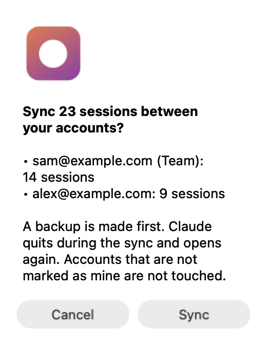
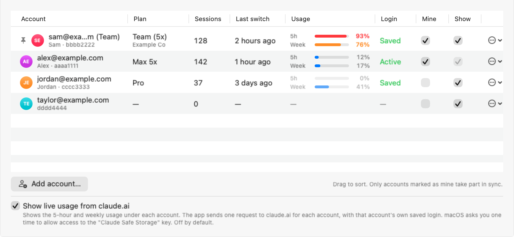
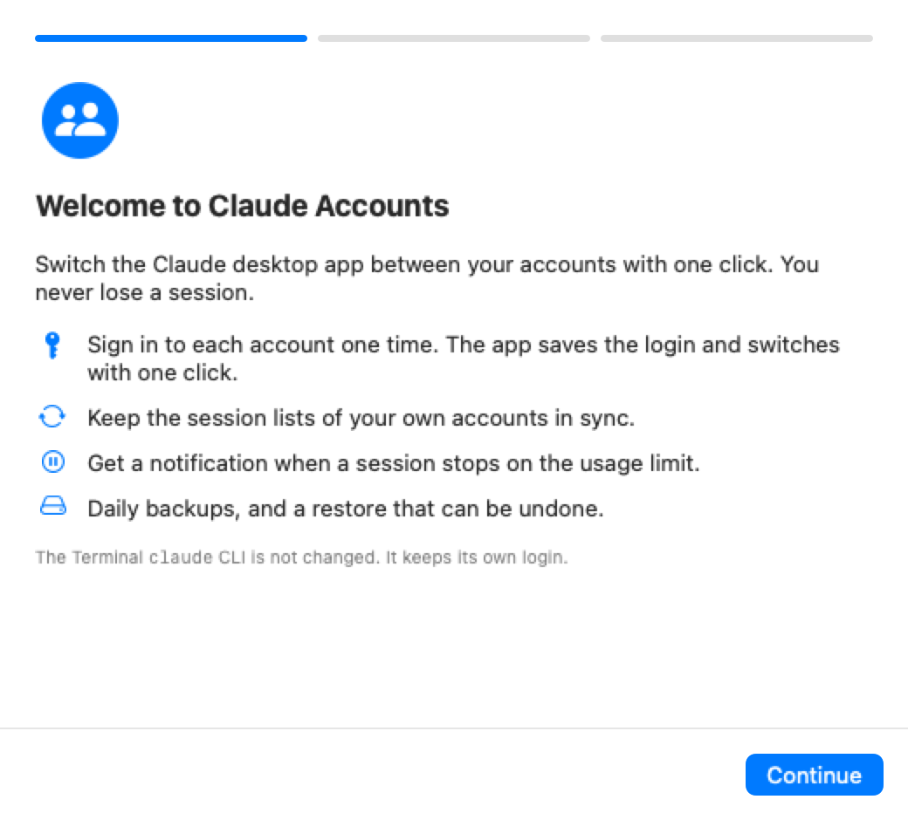

# Claude Accounts

> Unofficial. Not made by or affiliated with Anthropic.

A macOS menu bar app that switches the **Claude desktop app** between your accounts with one click. You sign in to each account one time. You do not lose sessions.

<p>
  <picture>
    <source media="(prefers-color-scheme: dark)" srcset="docs/screenshots/panel-dark.png">
    
  </picture>
  <picture>
    <source media="(prefers-color-scheme: dark)" srcset="docs/screenshots/sync-preview-dark.png">
    
  </picture>
</p>

<picture>
  <source media="(prefers-color-scheme: dark)" srcset="docs/screenshots/settings-accounts-dark.png">
  
</picture>

The screenshots use demo data. `scripts/screenshots.sh` makes them again.

## What it does

The Claude desktop app keeps one login at a time. To use another account, you must sign out and sign in again. Claude Accounts saves the login of each account. A switch quits Claude, saves the current login, loads the other login, and opens Claude again. Then it checks that the new login works.

Sessions are stored per account. Claude Accounts can sync the session lists of your own accounts, so every account shows every session.

## Features

- **One-click switch** from the menu bar panel.
- **Automatic login save.** Every 5 minutes, the app saves the login that Claude uses now.
- **Two-way session sync** between the accounts that you mark as "mine". You see a preview first, and a backup is made first. Accounts that are not "mine" are never read or written.
- **Stopped on usage limit.** The panel lists sessions that stopped on the usage limit, with the time the limit resets. A notification offers a switch to another of your accounts. The app never switches by itself.
- **Wrong-account warning** when the active account has few sessions and another account has many.
- **Daily backups and restore.** A restore backs up the current state first, so you can undo it.
- **Settings window** with General, Accounts, Sync, Backups, Advanced and About tabs.
- **First-run guide** that explains the app and helps you add your accounts.

New in 1.1:

- **Pin and sort.** Pin an account to the top of the panel. Drag to sort in Settings → Accounts.
- **Sign in to save.** An account without a saved login shows **Sign in to save**. The app guides you, then saves the login.
- **Usage reset time** under each account that stopped on the limit.
- **Keyboard shortcuts:** ⌃⌥⌘C opens the panel, ⌃⌥⌘N switches to the next account. You can turn each one off.
- **Remove account.** Its sessions move into the backups, so you can get them back.
- **Copy debug report** (Settings → About). Emails and account IDs show as "account 1", "account 2".
- **Uninstall** (Settings → About). Saved logins and backups stay.

<picture>
  <source media="(prefers-color-scheme: dark)" srcset="docs/screenshots/welcome-dark.png">
  
</picture>

## Install

Needs macOS 14 or later and the [GitHub CLI](https://cli.github.com) (`brew install gh`, then `gh auth login`).

```bash
gh release download --repo jomonkj/claude-accounts --pattern install-release.sh --output - | bash
```

The install script:

1. Downloads the latest release and checks its sha256.
2. Installs the app to `~/Applications`.
3. Removes the quarantine flag from the app.
4. Links the CLI commands into `~/.local/bin`.
5. Adds the login item and opens the app.

**Why the script removes the quarantine flag:** the app is not notarized by Apple. Notarization needs a paid Apple Developer account. Without it, macOS blocks a downloaded app that has the quarantine flag and says that it "cannot be opened". The script removes the flag only from this app, after it checks the sha256 of the download. If you prefer to do it by hand: download the zip from the Releases page, move the app to Applications, then **right-click it → Open → Open** the first time.

**Updates:** the app checks GitHub Releases once a day. When a new version exists, the panel shows **Update**.

**Uninstall:** Settings → About → Uninstall, or `claude-switch uninstall`.

## First use

1. Click the menu bar icon, then **Add account**.
2. Claude opens signed out. Sign in with your other account.
3. Do the same for each other account. Then use **Switch**.
4. Right-click your own accounts and click **Mark as mine**. Then **Sync now** keeps their sessions the same.

## CLI

The install links two commands: `claude-accounts` (a table of accounts) and `claude-switch` (the engine; most commands print JSON). `<account>` is a full account ID or its first 8 characters.

| Command | What it does |
|---|---|
| `status` | Accounts, saved logins, stopped sessions, settings |
| `list` | Table of accounts (the same as `claude-accounts`) |
| `switch <account> [--force]` | Quit Claude, save this login, load the other login, open Claude |
| `add` | Save this login, then open Claude signed out |
| `save-login <account>` | Save the login if Claude is signed in to that account |
| `sync [--dry-run]` | Two-way sync of session lists between "mine" accounts |
| `mine` / `not-mine <account>` | Mark an account as yours (sync uses only these) |
| `backup`, `backups`, `restore <name>` | Make, list and restore backups |
| `label [<account>] <name>` | Name an account |
| `forget <account>` | Delete the saved login of an account |
| `remove <account>` | Remove an account; its sessions move into the backups |
| `hide` / `unhide <account>` | Hide an account from the list |
| `pin` / `unpin <account>`, `order <account>...` | Pin to the top, set the order |
| `set <key> <value>` | Change a setting |
| `recover` | Finish or roll back a switch that stopped in the middle |
| `report` | Debug report with no emails and no account IDs |
| `uninstall` | Remove the app (in ~/Applications and /Applications), the login item and the CLI links |

Example:

```bash
claude-switch switch aaaa1111
claude-switch sync --dry-run
```

Run `claude-switch help` to see all commands.

## Safety design

The app changes files that the Claude desktop app owns. It is careful with them:

- **One engine.** Only the engine (`engine/claude-switch`, Python) changes files. The app calls it.
- **Journal.** A switch writes its progress to `journal.json` before each step: `started → saved → loaded → synced`. If the switch stops in the middle (for example, the Mac loses power), `recover` reads the journal. It rolls back to the last state, or it finishes the switch. The app runs `recover` when it starts. While a journal exists, all other changes are refused.
- **Last state.** Before every switch, the exact login state goes to `last-state`, so you can restore it.
- **Backups.** Sync, restore and remove always make a backup first. A daily backup goes to `~/Backups/claude-sessions`.
- **Sync never deletes.** The newest copy of each session wins. A session that you deleted in one account is not added back. Accounts that are not "mine" are not read and not written.
- **Layout check.** Before a switch, the engine checks that the Claude data folder has the layout it knows. If not, it stops and changes nothing.
- **Private files.** Saved logins are in `~/Library/Application Support/Claude Account Switcher/profiles`, readable only by you (mode 700). Every action is written to `switch.log` in the same folder.

Tests check this: `tests/crash_test.sh` stops the engine after each step and checks the recovery, and `tests/sync_property_test.py` checks the sync rules on 500 random stores.

### How the login is saved

The Claude desktop app keeps its login under `~/Library/Application Support/Claude`: the `Cookies` database, two keys in `config.json` (`oauth:tokenCacheV2`, `lastKnownAccountUuid`), and its web storage folders. These are encrypted with the key `Claude Safe Storage` in the macOS Keychain. That key is the same for every account, so a saved copy restores the login.

## Limits

- The app switches only the Claude desktop app. The `claude` CLI in a terminal has its own login.
- A switch stops tasks that run in Claude. Finish them first.
- If a saved login expires, the app tells you. Sign in again, and the app saves the new login.
- Sync only between your own accounts. Do not mark an account that another person uses as "mine".
- The app depends on how the Claude desktop app stores its files. If an update changes that, the layout check stops the switch.

## Build from source

Needs the Xcode Command Line Tools (`xcode-select --install`) and macOS 14 or later. Xcode is not needed.

```bash
scripts/install.sh                 # run all tests, build for this Mac, install
```

Development:

```bash
tests/engine_test.sh               # engine tests in a fake app folder
tests/crash_test.sh                # stop the engine at each switch step, then recover
tests/sync_property_test.py 500    # sync rules on random stores
tests/install_test.sh              # installer in a fake HOME (run ARCHS=arm64 scripts/build.sh first)
tests/ocr_check_test.sh            # the screenshot text check
swift run CoreTests                # app logic tests
scripts/build.sh                   # universal build into ./build (ARCHS=arm64 for a fast one)
scripts/screenshots.sh             # README screenshots, with a demo engine and demo data
swift scripts/ocr-check.swift --expect alex@example.com docs/screenshots/*.png
```

`scripts/screenshots.sh` builds a copy of the app with `scripts/demo/claude-switch` as its engine. The demo engine prints fixed demo data and reads no files. `scripts/ocr-check.swift` reads all text in the PNGs with the macOS Vision framework. It fails on any email that is not `@example.com`, on any `--deny` pattern, and when an `--expect` text is missing.

Layout:

```
engine/claude-switch          Python engine (all file work; the app calls it)
Sources/ClaudeAccountsCore/   models, engine client, rules (no UI)
Sources/ClaudeAccounts/       SwiftUI menu bar app
tests/                        engine, crash, sync, install and app logic tests
scripts/                      build, install, screenshots, OCR check
```

**Releases:** the release workflow (`.github/workflows/release.yml`) runs on a tag such as `v1.1.0`. It runs all tests, builds a universal app, zips it, and makes a GitHub Release.

## License

MIT. See [LICENSE](LICENSE).
